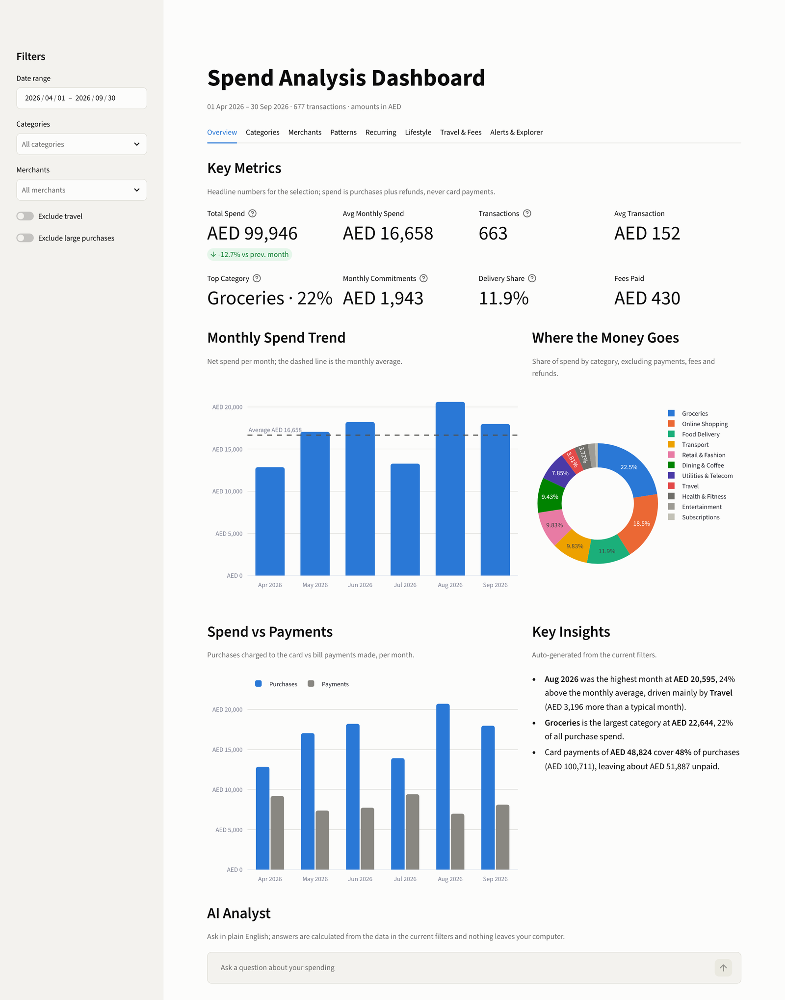

# Agentic AI Projects

A collection of data and AI projects built with Python and Claude Code.

## Projects

| Project | Description | Tech |
|---|---|---|
| [Spend Analysis Dashboard](spend-dashboard/) | Interactive dashboard analysing six months of credit card spending: KPIs, categories, recurring bills, FX costs and anomaly alerts. | Python, Streamlit, pandas, Plotly, uv |
| [FinePrint](fineprint/) | Evidence-grounded RAG assistant that answers questions about Emirates NBD current and savings accounts from the bank's Key Facts Statement, with claim-level citations and refusals. | Python, LangChain, LangGraph, Pinecone, Nebius Qwen3, RAGAS, Streamlit, uv |
| [RuleScope](rulescope/) | Evidence-grounded RAG assistant over 12 banking regulations: article-aware chunking and reranking raised right-article-first from 58% to 94%, every quote is verified in code, and off-topic questions are refused. | Python, LangChain, LangGraph, Pinecone, Nebius Qwen3, rapidfuzz, Streamlit, uv |
| [AML Investigation Dashboard](aml-investigation-agent/) | Multi-agent AML transaction triage dashboard with explainable risk scoring, High-risk human review, and case investigation. | Python, LangGraph, Streamlit, Pydantic, SQLite |
| [Wayfare Trip Agent](wayfare-trip-agent/) | Planning-only travel agent with a Planner → Critic → Revise loop, evaluated on a human-graded test set: one prompt change took over-promising failures from 3 to 0 with no regressions. | n8n, OpenAI, HTML/JS |

