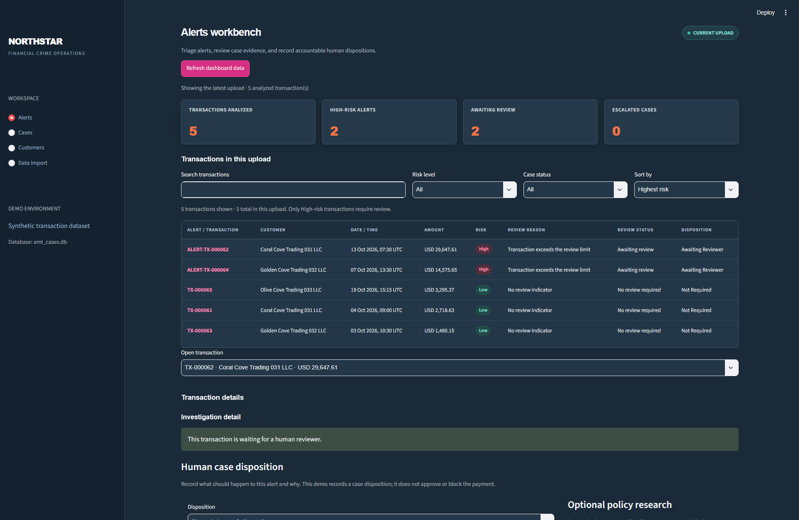
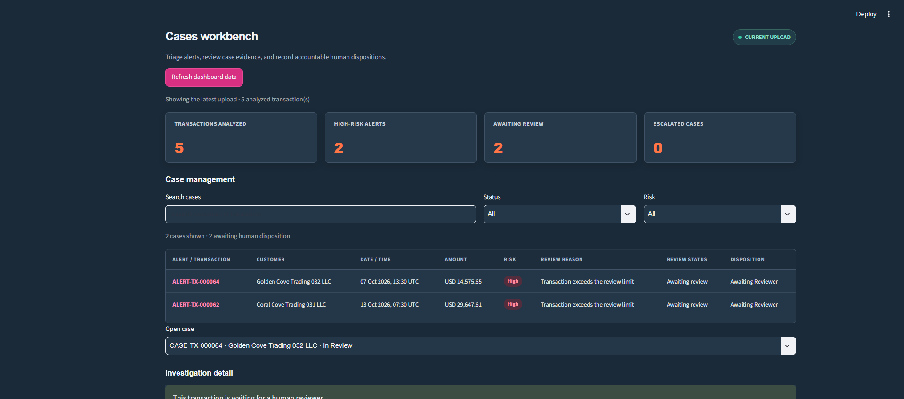
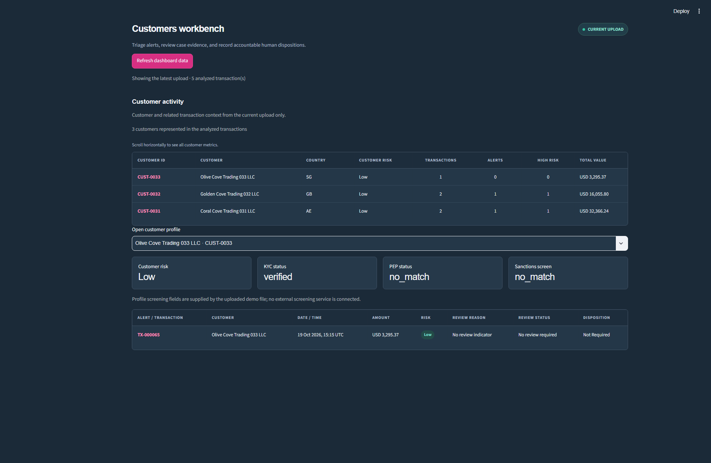
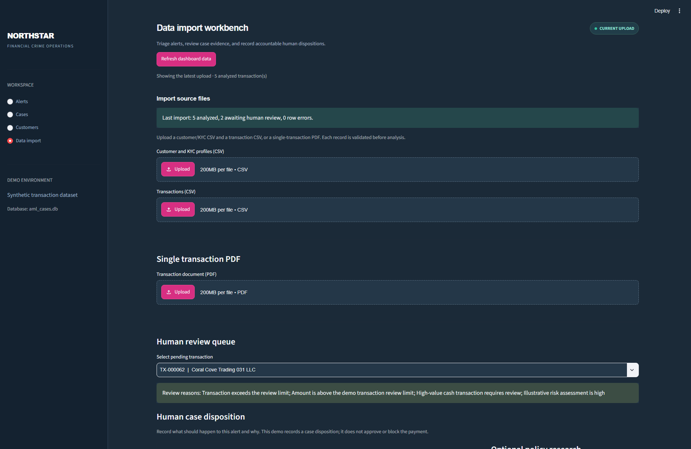
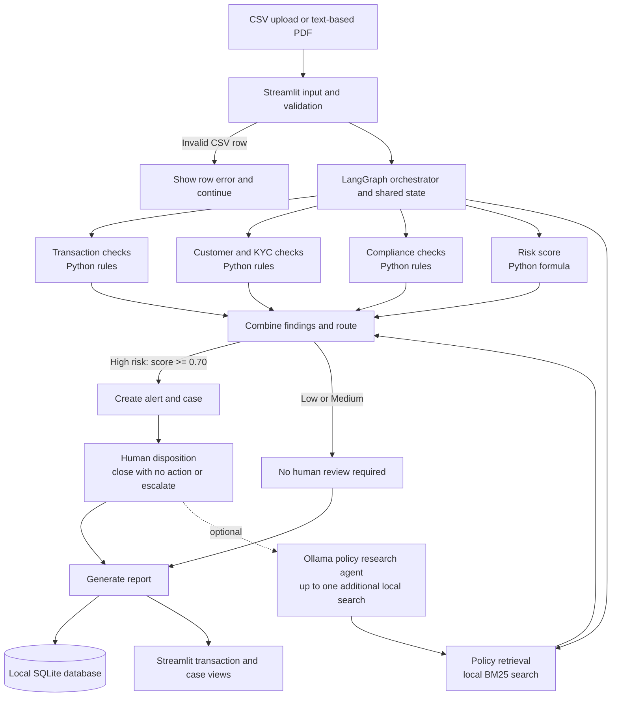

# Northstar AML Investigation Agent

An educational AML transaction triage application built with Python, LangGraph, and Streamlit. It analyzes fictional transactions with explainable rules, displays the results in a dashboard, and routes **High-risk transactions only** to human review.

> **For demonstration only.** The data, policy, score, and thresholds are fictional examples. Do not upload real customer or financial data or use this application to make real AML decisions.

## Features

- Upload linked customer/KYC and transaction CSV files, or extract one transaction from a text-based PDF.
- Validate records with Pydantic and report bad CSV rows while processing the rest of the batch.
- View all transactions in the latest upload, inspect their risk factors and source evidence, and filter/search the list.
- Calculate a transparent Low/Medium/High demo risk score.
- Create a case and pause for human disposition only when risk is High.
- Review retrieved fictional policy passages; optionally run one model-assisted local policy search for a High-risk case.
- Save completed analysis, cases, and case events in local SQLite.
- Evaluate saved results against a separate synthetic reference-label file.

## Dashboard screenshots

These screenshots use the fictional demo upload included with the project. The dashboard shows the alert queue, human review cases, customer activity, and data import workbench.



<details>
<summary>View the other dashboard workbenches</summary>

### Cases



### Customer activity



### Data import and human review



</details>

## Architecture



The LangGraph orchestrator coordinates specialist components that share a transaction state. Most checks are deterministic Python code, not independent LLM agents. The optional Ollama policy research agent can decide whether one additional local policy search would help a human reviewer; it cannot decide the case outcome.

## How it works

1. Upload customer/KYC profiles and transactions. The app joins them by `customer_id`.
2. Validate each record and run transaction, customer, compliance, risk, and local policy checks.
3. Combine findings and assign a risk level. Only High risk creates an alert and case requiring review.
4. A human reviewer records **Close alert — no further action** or **Escalate for further review**, with a rationale.
5. Generate the investigation report and save the completed result locally.

Human dispositions update the demo case workflow. They do not approve or block a payment, determine criminality, or file a regulatory report.

## Demo risk score

The illustrative score starts at **0.10** and adds points for these factors:

| Indicator | Points |
|---|---:|
| Amount greater than $10,000 | +0.35 |
| Cash channel | +0.25 |
| Customer KYC risk rating is High | +0.15 |
| Transaction is at least half of expected monthly turnover | +0.20 |
| Possible PEP screening match | +0.10 |
| Possible sanctions screening match | +0.20 |

The score is capped at 1.00. **Low** is below 0.40, **Medium** is 0.40 to below 0.70, and **High** is 0.70 or above. Under the current demo rule, only High risk is sent to human review. These thresholds are not calibrated for real use. In particular, real programs may need separate mandatory escalation rules for sanctions, PEP, data quality, and other signals.

## Quick start

Requirements: Python **3.11+** and [uv](https://docs.astral.sh/uv/).

From the repository root:

```powershell
uv sync
uv run streamlit run src/aml_agent/dashboard.py
```

Open the local URL printed by Streamlit, usually `http://localhost:8501`. In **Data import**, upload the customer CSV and transaction CSV. Start with a small transaction limit; set it to `0` to analyze all uploaded rows. The first workspace page displays all transactions from the latest upload.

### Optional local AI features

The PDF extractor and on-demand policy research agent use Ollama. Install and start Ollama, then make the configured model available locally. The default model is `gemma4:e4b`; the policy agent model can be changed with the `AML_POLICY_MODEL` environment variable. Normal CSV rule analysis does not need an LLM call for each transaction.

PDF uploads must contain selectable text. Scanned-image OCR is not configured.

## Included demo data

All supplied records and policy text are fictional.

| File | Purpose |
|---|---|
| `data/demo/customers.csv` | Synthetic customer/KYC profiles. |
| `data/demo/transactions.csv` | Synthetic transactions linked to the customer file. |
| `data/demo/reference_labels.csv` | Synthetic labels used only by the evaluation script, not by the investigation workflow. |
| `data/demo/sample_transaction_upload.pdf` | Example single-transaction PDF for the upload flow. |
| `data/policies/demo_aml_policy.md` | Fictional local policy text for retrieval. |
| `data/samples/` | Small examples for schema validation and text extraction. |

The database `data/aml_cases.db` is created locally as results are saved and is excluded from version control. It contains your local demo history and reviewer dispositions.

## Other commands

```powershell
# Process up to five bundled transactions; the CLI asks for a disposition on High risk.
uv run python src/aml_agent/try_batch.py

# Compare saved outcomes with the synthetic reference labels.
uv run python src/aml_agent/evaluate_demo.py

# Run the text extraction example (requires Ollama and its model).
uv run python src/aml_agent/try_extractor.py

# Run the schema validation example.
uv run python src/aml_agent/try_schema.py
```

To process the full bundled transaction CSV in the CLI:

```powershell
$env:AML_BATCH_LIMIT = "0"
uv run python src/aml_agent/try_batch.py
```

## Evaluation

After processing records, run `evaluate_demo.py`. It reports true alerts, correct clears, false alerts, missed reference cases, accuracy, precision, recall, specificity, and labeled transactions not yet processed. Reference labels are loaded only by this utility, after workflow processing, to avoid label leakage.

These results measure agreement with a small synthetic dataset only. They are not evidence of real-world AML effectiveness or regulatory compliance. Evaluation results are generated locally and are not included in the repository by default.

## Project structure

| Path | Purpose |
|---|---|
| `src/aml_agent/dashboard.py` | Streamlit dashboard, uploads, transaction views, case review, and PDF extraction. |
| `src/aml_agent/graph.py` | LangGraph state, workflow nodes, routing, human interrupt, and report generation. |
| `src/aml_agent/specialists.py` | Transaction/customer specialists and policy-agent components. |
| `src/aml_agent/risk_tools.py` | Illustrative risk calculation. |
| `src/aml_agent/policy.py` | BM25 retrieval over local policy files. |
| `src/aml_agent/schemas.py` | Pydantic input and output models. |
| `src/aml_agent/storage.py` | SQLite persistence and case-event history. |
| `src/aml_agent/evaluate_demo.py` | Synthetic-label evaluation utility. |
| `data/` | Demo records, example inputs, and fictional policy. |
| `docs/` | Project documentation, deployment notes, and rubric review. |

## Limitations

- This is a local educational proof of concept, not a production AML system.
- Risk rules and policy text are fictional and not calibrated or legally authoritative. Potential PEP/sanctions matches below High do not independently trigger review in the simplified routing rule.
- Most specialists are deterministic Python components; only optional extraction and policy research use a local model.
- Pending LangGraph checkpoints use in-memory storage. Restarting the app can prevent a pending case from being resumed, even though completed case data is in SQLite.
- User authentication, permissions, durable team queues, external screening providers, network analysis, OCR, tamper-evident audit storage, payment controls, and regulatory reporting are not implemented.
- Customer activity summarizes only the current upload, not full account history.

## More documentation

- [Week 3 project documentation](docs/week3_project_documentation.md) — detailed workflow, data, prompts, evaluation method, limitations, and rubric coverage.
- [Application code guide](src/aml_agent/README.md) — where to find each code component.
- [Data folder guide](data/README.md) — describes the data directories.
- [Synthetic demo dataset notes](data/demo/README.txt) — explains the upload files and labels.
- [Sample input guide](data/samples/README.md) — describes the small extraction/schema examples.
- [Documentation index](docs/README.md) — lists the project documents.
