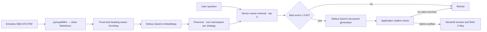

# FinePrint

> **Read the fine print of your bank account — with evidence.**

*Ask a plain-English question about Emirates NBD current and savings accounts and get an answer backed by the bank's own Key Facts Statement.*

FinePrint retrieves the relevant passages from the bank's official Key Facts Statement (KFS), generates an answer only from those passages, and checks every claim against a word-for-word quote before showing it.

FinePrint is an educational document-intelligence project, **not a financial advisor**. It does not provide personalized financial or legal advice.

## Product overview

The Streamlit application has one question box and two views:

1. **Answer** — the evidence state, the answer as numbered claims, and an expandable citation for each claim showing the KFS section, the exact quote, the chunk ID, and the source URL.
2. **RAG X-Ray** — the production configuration, the five retrieved chunks with their similarity scores, the end-to-end time, and a warning if any citation was rejected.

Every answer reports one of two evidence states: **Grounded** or **Insufficient Evidence**. When the document does not support an answer, FinePrint says so instead of guessing:

> I couldn't verify that from the bank's Key Facts Statement.

## The problem

A bank Key Facts Statement packs product features, fees, interest rates, eligibility rules and regulatory warnings into dense tables and repeated "Warning !!!" boxes. A generic chatbot may answer from outdated outside knowledge, confuse similar accounts, or invent a fee. FinePrint splits the task into controlled stages:

- extract the document's text and structure once, locally;
- retrieve only the passages relevant to the question;
- refuse when the best match is too weak;
- generate only from the retrieved passages;
- accept a claim only if its quote really appears in the cited passage.

## Why RAG

Retrieval-augmented generation keeps answers tied to one official document instead of treating model memory as authority. It also makes failure visible: if the evidence is weak or no claim survives the citation check, the workflow returns a refusal rather than a confident guess.

## Architecture



The production LangGraph ([step4_rag.py](step4_rag.py)) is deliberately small:

```text
START → retrieve
  ├─ best score < MIN_SCORE → refuse → END
  └─ best score ≥ MIN_SCORE → generate → validate → END
                                         (no verified claims → refusal)
```

There is no query rewriting, reranking, routing, or second RAG path in the UI. [app.py](app.py) calls the same `ask()` function that the evaluation scripts measure.

## Technology stack

- **Python 3.12** with **uv** for dependency management
- **pymupdf4llm** — local PDF-to-Markdown extraction that keeps tables and headings
- **LangChain** — document objects, token-aware text splitting, embedding and chat adapters, Pinecone integration
- **LangGraph** — the retrieve → decide → generate → validate workflow
- **Nebius Token Factory** — Qwen3 embeddings and answer generation through an OpenAI-compatible API
- **Pinecone** — serverless dense vector storage and cosine retrieval
- **RAGAS** — LLM-judged answer and context quality metrics
- **Streamlit** — the question-answering and inspection UI
- **pandas** and **tiktoken** — evaluation tables and token counting

## Corpus

The corpus is a single official document:

| Field | Value |
|---|---|
| Bank | Emirates NBD |
| Document | Key Facts Statement: Current and Savings Accounts (Individuals) |
| Source | https://www.emiratesnbd.com/kfs |
| Retrieved | 2026-10-15 |
| File | [`data/enbd_accounts_kfs.pdf`](data/enbd_accounts_kfs.pdf) (7 pages) |

Answers are only as current as that document. If the bank updates its KFS, the pipeline must be re-run.

## Ingestion and cleaning

[step1_ingest.py](step1_ingest.py) converts each page to Markdown with pymupdf4llm. Tables become Markdown tables, bold or large text becomes headings, and running page headers and footers are dropped. The cleaner then removes highlight tags, bold markers and in-cell line breaks, and collapses extra whitespace.

Two details matter for retrieval and citations:

- **Pages are joined** before saving, so a section that crosses a page break stays together.
- **Repeated headings are numbered.** The KFS contains eight sections all titled "Warning !!!". They become `Warning !!! (1)` … `Warning !!! (8)`, so each citation points to one specific warning.

The step stops if any page yields almost no text, which usually means a scanned page. OCR is not implemented. The output is [`data/clean.md`](data/clean.md).

## Chunking experiment: fixed vs. heading-aware

[step2_chunk.py](step2_chunk.py) builds two chunk sets from the same clean text, both measured in tokens (200 tokens with 30 overlap):

| Strategy | How it splits | Chunks |
|---|---|---:|
| **Fixed** | Token windows across the whole document, ignoring structure | 21 |
| **Heading-aware** | One piece per section; long sections are split further, and each extra piece repeats its heading | 31 |

Each set is stored in its own Pinecone namespace (`fixed`, `heading`) inside the `fineprint-nebius` index, so both can be compared on identical questions.

| Retrieval evaluation (12 answerable questions) | Precision@1 | MRR | Hit@5 |
|---|---:|---:|---:|
| Fixed | **83.3%** | 0.903 | **100.0%** |
| Heading-aware | **83.3%** | **0.917** | **100.0%** |

The decision rule, set before the run, required heading-aware chunking to beat fixed by **at least 5 points of Precision@1**. It gained **+0.0 points**, so **fixed chunking remains the production strategy**. Heading-aware chunking moved one miss from Q09 to Q07 and slightly raised MRR, but did not change how often the right chunk came first. On a short, table-heavy document, structure did not help retrieval in the way it might on a longer, prose-heavy corpus.

Per-question ranks are in [`reports/retrieval_details.csv`](reports/retrieval_details.csv).

## Embeddings and vector retrieval

Nebius Token Factory serves `Qwen/Qwen3-Embedding-8B` embeddings at **4,096 dimensions**. Pinecone stores them in a serverless cosine index (AWS `us-east-1`).

The production retriever uses:

- fixed 200/30-token chunks;
- dense cosine similarity;
- `TOP_K = 5`;
- `MIN_SCORE = 0.60` as the refusal threshold;
- no BM25, hybrid search, reranking or query rewriting.

All production settings live in [common.py](common.py), so the steps never hard-code values.

## LangChain and LangGraph roles

LangChain provides the document contract: each chunk carries its text plus application-owned metadata (chunk ID, section, bank, title, URL and retrieval date). It also supplies the token-aware splitter, the OpenAI-compatible embedding and chat adapters pointed at Nebius, and the Pinecone vector store.

LangGraph owns control flow. Each node does one job: `retrieve`, `refuse`, `generate` or `validate`. A conditional edge after retrieval decides whether there is enough evidence to continue. This keeps the UI thin: it displays the result of one function call and adds no retrieval logic of its own.

## Generation

Answers use `Qwen/Qwen3-30B-A3B-Instruct-2507` through Nebius Token Factory at temperature 0. The model receives the question and the five retrieved chunks, each labelled with its chunk ID and section. It must return structured output:

- `answerable` — false if the evidence does not answer the question;
- `claims` — each with a short statement, the supporting `chunk_id`, and an `excerpt` copied word for word.

The prompt forbids outside knowledge and requires amounts, rates and conditions to be copied exactly.

## Claim-level citations

Citation checking is done by the application, not the model. In the `validate` node, a claim is accepted only if:

- its excerpt is at least 10 characters after normalization, and
- that excerpt appears in one of the retrieved chunks.

If the model cites the wrong chunk ID but the quote exists in another retrieved chunk, the claim is relabelled to the correct chunk. Duplicate claims are dropped. Section, source title and URL are always taken from chunk metadata, so **the model cannot invent a source**. If no claim survives, the answer becomes the standard refusal.

## Refusal behavior

FinePrint refuses at two points:

1. **Before generation**, when the best retrieval score is below `MIN_SCORE`.
2. **After generation**, when the model marks the question unanswerable or no claim passes the citation check.

The frozen benchmark includes three deliberately unanswerable questions (overdraft rate, international wire fee, lounge access on a non-existent account). All three were refused: **3/3 (100%)**.

An honest note on the threshold: the retrieval report shows score overlap. The lowest top score for an answerable question was 0.631, while the highest for an unanswerable question was 0.672. A 0.60 threshold therefore does not separate them on its own, and in practice **the model's `answerable` flag and the citation check carry the refusal work**. With a single short document, almost any banking question finds a loosely related chunk.

## Evaluation

The questions in [`eval/questions.jsonl`](eval/questions.jsonl) were written with expected answer phrases and reference answers before results were inspected: **12 answerable** and **3 unanswerable**. The decision thresholds were also fixed in code before running.

[step5_eval_retrieval.py](step5_eval_retrieval.py) measures retrieval. [step6_eval_answers.py](step6_eval_answers.py) runs every question through the full workflow, applies plain-Python checks, and then uses RAGAS with Qwen3 as the judge.

| Final quality gate | Result |
|---|---:|
| Retrieval Precision@1 (fixed / heading-aware) | **83.3% / 83.3%** |
| Retrieval Hit@5 | **100.0%** |
| Answerable questions answered (Grounded) | **12/12** |
| Unanswerable questions refused | **3/3** |
| Citations rejected by the check | **0** |
| RAGAS faithfulness | **0.950** |
| RAGAS answer relevancy | **0.916** |
| RAGAS context precision (with reference) | **1.000** |
| RAGAS context recall | **1.000** |
| Latency median / p95 | **14.0s / 20.1s** |
| Latency target (p95 < 8s) | **NOT MET** |

How to read these numbers:

- RAGAS averages skip questions where the judge returned no score. Faithfulness was scored on 10 of 12 questions and context precision on only 3 of 12, so the 1.000 context precision rests on a small sample.
- Q02 ("Do I pay anything to open an account?") scored 0.5 faithfulness. The answer was correct, but the judge treated part of the wording as going beyond the quoted evidence.
- An earlier run, kept in [`reports/answers_v1.md`](reports/answers_v1.md), answered 11/12 with one rejected citation and a p95 of 282.9s caused by a slow provider response. The final run is in [`reports/answers.md`](reports/answers.md).

Faithfulness measures whether claims are supported by the retrieved evidence. It does not show that an answer is complete, or suitable for a specific customer's situation.

## Latency limitation

The final run measured a median of **14.0 seconds** and a p95 of **20.1 seconds**, so the precommitted `<8s` p95 target was **not met**. Generation with structured output dominates response time, and individual requests varied widely, from under 4 seconds to over 17 seconds. The UI shows a real spinner while work continues and reports the measured time in RAG X-Ray.

## Privacy and security

- The source document is a public bank disclosure. No customer data is ingested.
- User questions are sent to Nebius for embedding and generation, and query vectors are sent to Pinecone. Do not type personal account details into the app.
- API keys are loaded from a local `.env` file, which is listed in `.gitignore`. Keys must never be committed, displayed in the UI, or printed in logs.
- The project has no authentication, access control or audit logging and is not intended for production deployment.

## Local setup

Requirements:

- Python 3.12 and [uv](https://docs.astral.sh/uv/)
- a Nebius Token Factory API key
- a Pinecone API key

From the project root:

```powershell
uv sync
```

Create a `.env` file in the project root:

```text
NEBIUS_API_KEY=your-nebius-key
PINECONE_API_KEY=your-pinecone-key
```

## How to run

Run the pipeline in order. Each step reads the previous step's output.

```powershell
uv run python step1_ingest.py          # PDF → data/clean.md
uv run python step2_chunk.py           # clean.md → data/chunks_fixed.jsonl, data/chunks_heading.jsonl
uv run python step3_index.py           # embed chunks and upload to Pinecone
uv run python step4_rag.py "Is there a fee to open an account?"   # try one question
uv run python step5_eval_retrieval.py  # → reports/retrieval.md
uv run python step6_eval_answers.py    # → reports/answers.md, reports/ragas_scores.csv
```

Then launch the app:

```powershell
uv run streamlit run app.py
```

Open the local URL Streamlit prints, ask a question, read the answer and its citations, then open **RAG X-Ray** to see what was retrieved.

## Project structure

```text
fineprint/
├── app.py                     # Streamlit UI; calls ask() from step 4
├── common.py                  # all settings, model clients and shared helpers
├── step1_ingest.py            # PDF → clean Markdown with quality check
├── step2_chunk.py             # fixed and heading-aware chunking
├── step3_index.py             # embeddings → Pinecone namespaces
├── step4_rag.py               # LangGraph RAG workflow and citation check
├── step5_eval_retrieval.py    # Precision@1, MRR, Hit@5, score threshold help
├── step6_eval_answers.py      # grounding, refusals, latency, RAGAS
├── data/
│   ├── enbd_accounts_kfs.pdf  # the source document
│   ├── clean.md               # cleaned Markdown
│   ├── chunks_fixed.jsonl     # 21 fixed chunks
│   └── chunks_heading.jsonl   # 31 heading-aware chunks
├── eval/
│   └── questions.jsonl        # 12 answerable + 3 unanswerable questions
├── reports/                   # evaluation outputs
└── pyproject.toml             # dependencies (managed by uv)
```

## Learnings

- **Measure before adding complexity.** Heading-aware chunking sounded better but gave no Precision@1 gain on this document, so the simpler strategy stayed.
- **Small fixes in ingestion pay off.** Numbering the eight identical "Warning !!!" headings made every citation point somewhere specific.
- **A similarity threshold alone is not a safety net.** Answerable and unanswerable scores overlapped. The structured `answerable` flag and the citation check did the real refusal work.
- **Citations need application ownership.** Checking that each quote exists in the cited chunk, and taking metadata from the chunk rather than the model, stops invented sources from reaching the UI.
- **Read metric averages carefully.** RAGAS silently skips questions it cannot score, so a perfect average can rest on very few questions.
- **Latency is a quality metric.** Answers were grounded and refusals correct, but the system missed its speed target, and that is reported rather than hidden.
