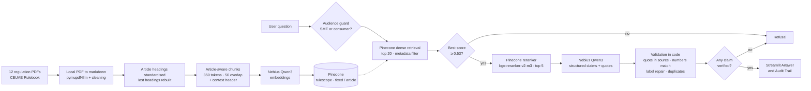

# RuleScope

> **Ask the banking regulations, get the article and the exact quote.**

*Ask a plain-English question about retail-banking and consumer-protection rules and get an answer in which every point cites the regulation, the article and an exact quote from the official text, checked in code.*

RuleScope is an evidence-grounded retrieval-augmented generation (RAG) project over **12 regulations from the Central Bank of the UAE (CBUAE) Rulebook**. It retrieves candidate passages, reranks them, generates structured claims, and lets the **application rather than the model** decide which quotes are real. When the regulations do not answer the question, it says so.

RuleScope is an independent, educational project and **not legal or compliance advice**. The Rulebook has no legal effect; the officially issued regulations prevail. It is not affiliated with the Central Bank of the UAE.

## Results at a glance

| Measure | Result |
|---|---:|
| Right article first (P@1), fixed-chunk baseline → final | **58.1% → 93.5%** |
| Right article in the top 5 (Hit@5) | **71.0% → 96.8%** |
| Out-of-scope questions refused | **6/6** |
| Answerable questions wrongly refused | **0/31** |
| Answers judged correct (LLM judge, spot-checked) | **30/31**, 0 wrong |
| Model claims caught by code (dropped or label repaired) | **2 of 77** |
| Median response time | **8.6s** |

Measured on a frozen 37-question test set with decision rules set before any result was seen (details under Evaluation).

## Product overview

The Streamlit app has a sidebar and two views:

1. **Sidebar:** choose which of the 12 regulations to search (all by default), one-click example questions, and a short "How RuleScope works".
2. **Answer:** a bullet answer with numbered citations. Under it, each source shows the regulation, article and sub-section, its reference and effective date, the **verified quote**, and a link to the official Rulebook page. A refusal shows the reason.
3. **Audit Trail:** the detected audience (consumer or SME), time per stage, all 20 retrieved candidates with similarity scores, which 5 the reranker kept (S1–S5) and their rerank scores, the refusal-gate result, the passages given to the model, and what validation dropped or repaired.

Every answer ends either **verified** (at least one claim with a checked quote) or as the refusal *"I couldn't verify that from the Central Bank regulations in RuleScope."*

## The problem

Compliance analysts, bank staff and customers often need to know *what the regulation actually says*: when must a customer receive the Key Facts Statement, when does an account become dormant, at what hours may a bank telemarket? The answers sit across 12 long documents (556 pages, over 800,000 characters). Several are bilingual English–Arabic PDFs, some headings cannot be extracted, and the **retail and SME consumer-protection rules use almost identical wording** while applying to different customers. A general chatbot may answer from memory, mix the two rulebooks, or cite the wrong article.

RuleScope controls each stage:

- extract every PDF locally, keep tables, drop Arabic text, contents pages and running headers;
- standardise every article heading, and **rebuild headings the PDF layout lost** from the clause numbering;
- cut the text **by article**, never across two articles, with a context header on every chunk;
- keep retail and SME rules apart with a **metadata filter**, not a prompt;
- refuse **before generation** when nothing relevant is retrieved;
- **rerank** 20 candidates down to 5;
- generate only structured claims with exact quotes;
- **verify every quote in code**, including that every number in it appears in the source.

## Why RAG

Regulations change, and a model's memory is neither current nor citable. Retrieval-augmented generation keeps every answer tied to the frozen regulation text, so each claim can point to the article and quote it came from. It also makes failure explicit: when nothing relevant is retrieved, or no quote can be verified, the workflow refuses instead of answering from memory.

## Architecture



The production LangGraph:

```text
START → retrieve (top 20, audience filter)
          → gate
              ├─ best score < 0.53 → END                         REFUSED (no model call)
              └─ enough evidence → rerank (top 5) → generate → validate
                                                        ├─ no verified claim → END   REFUSED
                                                        └─ verified claims → END     ANSWER + citations
```

The app, the demo and both evaluations call the same `answer()` function, so what is measured is what users get.

## Technology stack

- **Python 3.12** with **uv** for environments and dependencies
- **pymupdf4llm**: local PDF → markdown, keeping tables and headings
- **LangChain**: token-aware text splitting, embedding and vector-store integrations, structured output
- **LangGraph**: the retrieve → gate → rerank → generate → validate workflow
- **Nebius Token Factory** (OpenAI-compatible API): Qwen3 embeddings and generation
- **Pinecone** (serverless): dense vector storage, metadata filtering, and the hosted `bge-reranker-v2-m3` reranker
- **rapidfuzz**: fuzzy quote matching in the validator
- **Streamlit**: the user interface

No guardrail library, query rewriting, BM25 or hybrid search, agent loop, authentication layer or database is part of the project.

## Corpus

Twelve documents from the public **CBUAE Rulebook**, listed with their official page and PDF links in [`data/corpus_manifest.csv`](data/corpus_manifest.csv):

| Group | Documents |
|---|---|
| Retail customer protection | Consumer Protection Regulation · Consumer Protection Standards · Regulation 29/2011 on Bank Loans · its Clarifications and Guidelines Manual · Mortgage Loans Regulation |
| Specific topics | Dormant Accounts and Unclaimed Funds · Ombudsman Unit · Telemarketing |
| Payments | Retail Payment Services and Card Schemes · Stored Value Facilities |
| Deliberate test cases | SME Customer Protection (near-identical wording to the retail rules) · Guidance Note on AI and Machine Learning |

**The PDFs and their extracted text are not in this repository.** The Rulebook permits personal, non-commercial download with the © notice; `step0_download.py` rebuilds the corpus from the official links and records the retrieval date. © Central Bank of the UAE.

## Download (`step0_download.py`)

Downloads each PDF listed with `include = yes`, checks that it really is a PDF (`%PDF` header) with selectable text, waits 2 seconds between requests, writes the retrieval date into the manifest and a status report to `reports/download_report.csv`. Result: **12/12 OK**.

## Ingestion and cleaning (`step1_ingest.py`)

`pymupdf4llm` reads each page as markdown (no OCR). The cleaner removes formatting tags (`<u>`, `<sup>`, `**`, `<br>`), **Arabic text** from bilingual pages, table-of-contents rows, and short lines repeated on at least 60% of pages (running headers and footers).

Every article heading, however it is written (`Article 7`, `Article (7)`, `ARTICLE 7:`), is rewritten as `## Article 7: Title`. Titles are cleaned of numbering that bilingual layouts glue onto them (`Business Conduct : 5 5.1 Responsible…` → `Business Conduct`).

**Rebuilding lost headings.** In the Consumer Protection Standards, the headings of Articles 2 and 3 cannot be extracted, so 76 chunks were labelled "Article 1: Definitions". Their clauses are still numbered (`2.1.1.19 …`), so a second pass inserts `## Article 2` before the first clause numbered `2.x`, **only for a number missing from the sequence** and never for an article already found. Definitions dropped from **76 chunks to 3**.

A report (`reports/ingest_report.csv`) records pages, characters, articles, tables and empty pages per regulation.

## Chunking experiment: fixed vs article-aware (`step2_chunk.py`)

Two strategies, each with ~350-token chunks and 50-token overlap. Every chunk starts with a context header such as `[Consumer Protection Standards | Article 2 > 2.1.3 General Provisions for Credit / Financing Products]`.

| Strategy | Chunks | Chunks mixing two articles | Labelled with an article | Median size |
|---|---:|---:|---:|---:|
| Fixed-size | 608 | 35 | 95% | ~1,550 chars |
| Article-aware (cut at every article, long articles split further) | 679 | **0** | 96% | ~1,480 chars |

The unlabelled remainder is genuine preamble before Article 1.

## Embeddings and retrieval (`step3_index.py`)

Nebius serves `Qwen/Qwen3-Embedding-8B` at **4,096 dimensions**. Pinecone stores the vectors in the `rulescope` index, one namespace per chunking strategy, emptied before each upload so reruns never mix versions. Every vector carries application-owned metadata: chunk ID, regulation ID and title, article, sub-section, reference, effective date and official page URL.

**Audience guard.** A question mentioning SME, small and medium, business, company, enterprise or corporate is an SME question: it searches with a Pinecone filter that excludes the retail-only regulations. Any other question excludes the SME regulation. The other nine regulations are searchable by both.

## Reranking

Pinecone's hosted `bge-reranker-v2-m3` cross-encoder reads the question together with each of the 20 candidates and keeps the best 5, labelled S1–S5 for the model.

## LangChain and LangGraph roles

LangChain provides the plumbing: token-aware splitting, the OpenAI-compatible embedding and chat adapters pointed at Nebius, the Pinecone vector store with metadata filters, and structured output. Chunk text travels with application-owned metadata (regulation, article, sub-section, reference, effective date, URL, chunk ID).

LangGraph owns control flow. Each stage is a small node that reads and writes one shared state, and the gate's refusal is an explicit branch rather than a prompt suggestion, so weak evidence cannot fall through to generation. The same state feeds the Audit Trail. The UI stays thin: `app.py` only calls `answer()` in `step4_rag.py`; there is no second RAG path.

## Generation (`step4_rag.py`)

Answers use `Qwen/Qwen3-30B-A3B-Instruct-2507` via Nebius at temperature 0, with a 60-second timeout and 2 retries, and **structured output**. The model returns a list of claims, each with:

- `statement`: one short factual statement;
- `source`: the label of the supporting passage (S1–S5);
- `quote`: words copied exactly from that passage.

The prompt also asks the model to prefer rules over definitions, keep SME and retail rules apart, give no personal advice and return no claims when the sources do not answer.

## Claim-level citations

Citation provenance is controlled by the application, not the model. Each quote is normalised (case, spacing, curly quotes, markdown symbols) and scored against **all five** passages:

- an exact match scores 100; otherwise `rapidfuzz.partial_ratio` scores the best-matching stretch, and a claim needs **≥ 90**;
- **number rule:** every number in the quote must appear in the passage. In testing, fuzzy matching alone let "1 days" pass for "3 days";
- an exact match always wins, and ties go to the source the model named;
- **label repair:** a real quote attributed to the wrong passage is re-attributed to the one that contains it;
- **duplicate removal:** near-identical statements (token-set similarity ≥ 90) are shown once;
- quotes shorter than 15 characters are rejected;
- regulation, article, reference, effective date and URL always come from stored metadata.

Every repair, approximate match and dropped claim is recorded and shown in the Audit Trail.

## Refusal behavior

RuleScope refuses in two places:

1. **Before generation**, when the best similarity score is below `MIN_SCORE = 0.53`. This needs no model call.
2. **After validation**, when no claim survives the quote check.

## Evaluation

The decision rules were set **before** results were inspected. The frozen test set (`eval/questions.jsonl`) has **37 questions**:

- **31 generated:** drafted by the LLM from one known chunk each (2–4 per regulation, rule-bearing articles only, everyday wording, a different article per question), so each has a known **regulation, article and reference answer**; reviewed by hand, and four rewritten to remove ambiguity;
- **6 out of scope:** best savings rate, VAT rate, golden visa, a bank's share price, a poem, and crypto AML rules from another regulator.

### Retrieval (`step5_eval_retrieval.py`)

Each question is searched once per strategy; the "with" and "without reranker" set-ups reuse the same 20 candidates, so the reranker is the only difference. A chunk is correct when it comes from the expected regulation **and** article. "Family" scores also accept the twin document at the same article (Regulation 29/2011 ↔ its Clarifications; Consumer Protection Regulation ↔ its Standards).

| Set-up | P@1 | MRR | Hit@5 | Doc@1 | Family P@1 | Family Hit@5 | Median time |
|---|---:|---:|---:|---:|---:|---:|---:|
| Fixed, no reranker | 58.1% | 0.617 | 71.0% | 80.6% | 64.5% | 80.6% | 0.69s |
| Fixed + reranker | 58.1% | 0.668 | 77.4% | 90.3% | 64.5% | 80.6% | 2.18s |
| Article-aware, no reranker | 64.5% | 0.729 | 87.1% | 90.3% | 67.7% | 90.3% | 0.67s |
| **Article-aware + reranker** | **93.5%** | **0.944** | **96.8%** | **96.8%** | **96.8%** | **96.8%** | 1.92s |

**Decision rules:** each feature must improve P@1 by at least 5 points.

- Reranker: **+14.5 points** (average over both strategies) → **kept**.
- Article-aware chunking: **+20.9 points** (average over both reranker settings) → **kept**.

**The interaction is the finding:** the reranker added **0 points** on fixed chunks and **+29 points** on article-aware chunks. A fixed chunk that spans two articles carries only one label, so even a correct rerank can return the wrong citation. Structure-aware chunking is what makes reranking effective here.

**Threshold calibration.** Best similarity per question (article-aware namespace):

- answerable questions: lowest **0.545**;
- out of scope: crypto AML **0.613**, savings rate **0.517**, golden visa **0.477**, VAT **0.474**, poem **0.464**, share price **0.460**.

At the original `0.60`, three answerable questions were wrongly refused. The ranges **overlap** (the crypto AML question looks on-topic), so no threshold separates them. `MIN_SCORE = 0.53` sits between 0.517 and 0.545: it refuses the five clearly off-topic questions instantly and never refuses a real one. The overlapping case is left to validation.

### Answers (`step6_eval_answers.py`)

Full pipeline, production settings, all 37 questions. Correctness is graded by an LLM judge comparing each answer with the reference answer (correct / partial / wrong), with a one-line reason per verdict.

| Measure | Result |
|---|---:|
| Out-of-scope questions refused | **6/6** |
| Answerable questions wrongly refused | **0/31** |
| First citation = expected article | **29/31** |
| Any citation = expected article (twin documents allowed) | **30/31** |
| Judge: correct / partial / wrong | **30 / 1 / 0** |
| Claims written by the model | 77 |
| Claims dropped by validation | 1 |
| Citation labels repaired | 1 |
| Latency median / slowest | **8.6s / 43.1s** |
| Median per stage | retrieve 2.7s · rerank 1.3s · generate 4.0s |

The crypto AML question passed the similarity gate and was refused by validation ("no claim could be verified"): **two refusal layers, each catching what the other misses.**

Full outputs: `reports/retrieval_eval.csv`, `reports/retrieval_summary.csv`, `reports/answer_eval.csv`.

### What changed during the build

| Problem found | How it was found | Fix |
|---|---|---|
| Fixed chunks only 60% labelled (vs 96%) | A metric that made no sense | LangChain's `add_start_index` treats the token overlap as characters and returns −1. Reproduced in isolation; replaced with a sequential position search → 95% |
| KFS answer cited "Article 1: Definitions" | Chunks-per-article count (76 in Definitions) | Rebuild lost headings from clause numbers → 3 |
| Retail answers cited the SME regulation, and the reverse | Reading the demo answers | Audience guard as a Pinecone filter (the prompt alone failed) |
| Good claims dropped over a curly apostrophe | Validation notes | Fuzzy matching ≥ 90, plus the number rule |
| Three real questions refused | Threshold calibration | `MIN_SCORE` 0.60 → 0.53 |

**Caveat:** these fixes were made while building and are evaluated on the same frozen set. A hand-written held-out set is listed under Next steps.

### Why not RAGAS here

The test set records the correct article for every question, so retrieval is measured **exactly** (P@1, MRR, Hit@5) rather than estimated by an LLM. Faithfulness is **enforced in code** for every displayed claim, so the more useful number is how often the model tried to say something unsupported (2 of 77). Refusal accuracy, essential for a compliance tool, is not covered by RAGAS.

## Latency

Median **8.6s**; generation with the 30B model is the slowest stage (4.0s median). One answer took 43.1s, a provider spike that the 60-second timeout bounds. Questions refused by the gate return in a few seconds because the model is never called.

## Privacy and security limitations

RuleScope answers from public regulations only and needs no customer data. Even so:

- Do not type personal or account details into questions. There is no detection or masking of personal data.
- Each question is sent to Nebius (embedding and generation) and its embedding to Pinecone (search and reranking). Retrieved regulation text is sent to Nebius for generation.
- Questions and answers are not stored by the application, but the providers' own retention terms apply.
- There is no authentication, access control, audit store or compliance certification.
- Do not deploy it for a bank's internal policies or customer-facing use without a separate privacy, security, data-residency and threat-model review. A production version would add personal-data and prompt-injection checks and could use self-hosted models.

API keys must never be committed, displayed in the UI or printed in logs.

## Known limitations

- **Generated questions may favour article-aware chunking**, since they were drafted from article chunks. Family scores (64.5% vs 96.8%) show the gap is not caused by twin documents.
- **Self-judging:** correctness is judged by the same model family; verdicts were spot-checked by hand.
- **Keyword audience guard:** "I run a shop" is treated as a retail question.
- **Superseded rules:** an older regulation can be quoted accurately while a newer one governs. For example, telemarketing hours differ between Regulation 29/2011 and the 2026 Telemarketing Regulation. Effective dates are shown; conflicts are not yet detected.
- **Rebuilt headings have numbers but no titles** (Standards Articles 2 and 3).
- **Annexes** after the last article of the Retail Payments regulation are labelled as that article.
- **Small margin** in the refusal gate (0.517 vs 0.545).
- **Point-in-time data:** regulations change; check the retrieval date in the manifest.
- No offline unit tests yet.

## Local setup

Requirements: Python 3.12, [uv](https://docs.astral.sh/uv/), a Nebius Token Factory API key and a Pinecone API key.

```powershell
git clone https://github.com/liajohn18/rulescope.git
cd rulescope
uv sync
Copy-Item .env.example .env      # then put your real keys in .env
```

`.env` must contain `NEBIUS_API_KEY` and `PINECONE_API_KEY`. It is listed in `.gitignore` and must never be committed. All settings (paths, models, chunk size, index name, `STRATEGY`, `CANDIDATES`, `TOP_K`, `USE_RERANKER`, `MIN_SCORE`) live in `common.py`.

## How to run

```powershell
uv run python step0_download.py         # 12 PDFs -> data/pdfs/ (+ download report)
uv run python step1_ingest.py           # PDFs -> data/clean/*.md (+ ingest report)
uv run python step2_chunk.py            # fixed and article-aware chunks
uv run python step3_index.py            # embed + upload to Pinecone
uv run python step4_rag.py              # 5 demo questions in the terminal
uv run python step5_eval_retrieval.py   # 2x2 retrieval comparison + gate calibration
uv run python step6_eval_answers.py     # full-pipeline answer evaluation
uv run streamlit run app.py             # the app at http://localhost:8501
```

Try: *"When must a bank give a customer the Key Facts Statement?"* (Consumer Protection Standards, Article 2), *"Does a bank have to give an SME a Key Facts Statement?"* (switches to SME rules only), *"What hours are banks allowed to make telemarketing calls?"*, and *"Which bank has the best credit card rewards?"* (refused; low scores visible in the Audit Trail).

## Project structure

```text
rulescope/
├── app.py                     # Streamlit UI: Answer + Audit Trail
├── common.py                  # all settings and shared helpers
├── step0_download.py          # manifest -> PDFs, checks, retrieval dates
├── step1_ingest.py            # PDF -> clean markdown, article headings, lost headings rebuilt
├── step2_chunk.py             # fixed vs article-aware chunking
├── step3_index.py             # Qwen3 embeddings -> Pinecone namespaces
├── step4_rag.py               # LangGraph: retrieve -> gate -> rerank -> generate -> validate
├── make_questions.py          # draft, review and freeze the test set
├── step5_eval_retrieval.py    # P@1, MRR, Hit@5, decisions, gate calibration
├── step6_eval_answers.py      # refusals, citations, LLM judge, grounding, latency
├── check_labels.py            # helper: chunks per article, to spot missed headings
├── data/corpus_manifest.csv   # the 12 regulations with official links (PDFs not committed)
├── eval/questions.jsonl       # frozen 37-question test set
├── reports/                   # download, ingest and evaluation reports
├── .env.example               # required key names, no values
└── pyproject.toml / uv.lock   # dependencies
```

## Learnings

- **Most accuracy is won in data preparation.** Rebuilding lost headings and cutting by article did more than any model setting.
- **Features can depend on each other.** The reranker was worthless on fixed chunks and decisive on article-aware chunks; testing them separately would have discarded it.
- **Prompts ask, code enforces.** The prompt did not keep SME and retail rules apart; a metadata filter did. Quotes and numbers are checked by code, not by another model.
- **Decision rules belong before the results.** The +5-point rule and the frozen test set make the 58% → 94% claim credible.
- **A metric that makes no sense is a bug report.** The 60% vs 96% labelling gap led to a library bug that no error message would have shown.
- **Refusal is part of the product,** and it needs layers: a calibrated gate for the obvious cases, validation for the near-misses.

## Next steps

- **KFS compliance checker:** upload a product's Key Facts Statement and check it against the disclosure articles.
- **Conflict and supersession detection:** when passages from different regulations disagree, show both with their effective dates.
- **User-selected audience** (individual or business) instead of keywords.
- **Hand-written held-out questions:** look-alikes, cross-regulation questions and advice requests.
- Titles for rebuilt articles, separate labels for annexes.
- Offline unit tests for the validator, the heading rebuilder and the audience filter.