# RuleScope

> **Know what the regulation actually says — with evidence.**

*Ask a question about banking rules in plain English. Get a short answer that shows the exact article and the exact words it came from.*

RuleScope searches twelve official banking regulations, picks the passages that answer your question, and writes a short answer. Every point in the answer comes with a quote from the regulation, and the program checks that each quote really appears in the source before showing it. If it cannot find proof, it says so instead of guessing.

RuleScope is a learning project, **not legal or compliance advice**. The source Rulebook itself states that it has no legal effect; the officially issued regulations always take priority.


## Product overview

The app has two views and a side panel:

1. **Answer** — type a question and get a short answer. Each point has a number like [1]. Under the answer, each source shows the regulation, the article, the exact quote, the effective date, and a link to the official page.
2. **Audit Trail** — see how the answer was built: which passages were found, their scores, which five were kept, and anything the checker removed or corrected. This lets anyone check the work.
3. **Side panel** — choose which regulations to search and click example questions.

Every answer ends in one of two ways: **Verified** (at least one point with a checked quote) or **Refused** (*"I couldn't verify that from the Central Bank regulations in RuleScope."*). A wrong regulation, a made-up quote or a wrong number is never shown as an answer.


## The problem

Banking regulations are long and hard to search. The twelve documents in RuleScope add up to 556 pages. Several are printed in English and Arabic side by side, which breaks normal text extraction. The rules for individual customers and for small businesses (SMEs) use almost the same words but apply to different people.

A general chatbot can answer from out-of-date memory, quote the rule for the wrong type of customer, or point to the wrong article. RuleScope avoids this by working in clear steps:

- clean the official text and repair article headings the PDFs lost;
- cut the text at every article, so no piece mixes two articles;
- work out whether the question is about individuals or SMEs, and search only the right rules;
- stop early if nothing relevant is found;
- re-check the best matches so the one that answers the question comes first;
- let the AI answer only with short points, each backed by a quote;
- check every quote, and every number in it, in code before anything is shown.

## Why RAG

RAG (retrieval-augmented generation) means the AI first **looks up** the relevant text and then answers **only from what it found**, instead of relying on what it remembers. For regulations this matters for two reasons. Rules change, so memory goes out of date. And every answer can point to the article it came from, so anyone can check it. When nothing relevant is found, the system refuses instead of making something up.

## Key terms

| Term | Plain meaning |
|---|---|
| Chunk | A small piece of a regulation (about one page) that can be searched |
| Embedding | A list of numbers that captures the meaning of a piece of text, so similar meanings can be found |
| Similarity score | How close a piece of text is in meaning to the question (higher is closer) |
| Reranker | A second, more careful check that reads the question and each passage together and picks the best ones |
| Precision@1 (P@1) | How often the very first result is the right article |
| Hit@5 | How often the right article is anywhere in the top five results |
| MRR | A score for how high the right article appears on average (1.0 means always first) |
| Frozen test set | Test questions fixed before any results were seen, and never changed afterwards |

## Architecture

```mermaid
flowchart LR
    A[Official regulation PDFs] --> B[Convert to text, keep tables]
    B --> C[Clean text and repair article headings]
    C --> D[Cut at every article]
    D --> E[Turn each piece into an embedding]
    E --> F[(Store in Pinecone)]
    Q[Your question] --> G[Individual or SME question?]
    G --> H[Find the 20 closest pieces in the right rules]
    F -.-> H
    H --> I{Close enough?}
    I -->|no| R[Refuse]
    I -->|yes| J[Reranker keeps the best 5]
    J --> K[AI writes short points, each with a quote]
    K --> L[Code checks every quote and number]
    L -->|nothing checks out| R
    L -->|verified| M[Answer and Audit Trail]
```



The answering workflow is deliberately small:

```text
START → find 20 closest pieces (only in the right rules)
  → is the best one close enough (score ≥ 0.53)?
       ├─ no  → END                                        REFUSED
       └─ yes → keep the best 5 → AI writes points → check every quote
                                                    ├─ none check out → END   REFUSED
                                                    └─ checked → END          VERIFIED
```

There is no query rewriting, agent loop, or second hidden way of answering. The app and the tests use the same `answer()` function, so what was measured is exactly what users get.

## Technology stack

- **Python 3.12** with **uv** — the programming language, and a tool that installs the exact same package versions on any computer
- **pymupdf4llm** — turns PDFs into text on your own computer while keeping tables and headings
- **LangChain** — ready-made parts for cutting text, connecting to the AI models and the database, and getting answers in a fixed format
- **LangGraph** — runs the answering steps in order, with a clear "stop and refuse" branch
- **Nebius Token Factory** — hosts the Qwen3 AI models that create embeddings and write answers
- **Pinecone** — the search database; it also hosts the reranker
- **rapidfuzz** — compares the AI's quote with the source text to confirm it is really there
- **Streamlit** — the web app

No guardrail library, keyword search, agent loop, login system or other database is used.

## Corpus

The search covers **12 regulations from the public Central Bank of the UAE (CBUAE) Rulebook**:

- **Individual customer protection:** the Consumer Protection Regulation and its Standards, the bank loans regulation (29/2011) and its clarifications manual, and the mortgage loans regulation.
- **Specific topics:** dormant accounts and unclaimed funds, the banking ombudsman, and telemarketing.
- **Payments:** retail payment services and card schemes, and stored value facilities (e-wallets).
- **Two deliberate test cases:** the SME Customer Protection Regulation, whose wording closely matches the individual-customer rules, and the guidance note on the use of AI.

The list of documents, with titles, effective dates and official links, is in [`data/corpus_manifest.csv`](data/corpus_manifest.csv). The PDFs and their text are **not** stored in this repository: the Rulebook allows personal, non-commercial download with credit, so [`step0_download.py`](step0_download.py) downloads them again from the official links. © Central Bank of the UAE.

## Ingestion and cleaning

The download step fetches only the listed files, checks that each one is a real PDF with readable text, and pauses between downloads. All twelve passed.

The cleaning step turns each page into text and then:

- removes formatting marks, the Arabic text on bilingual pages, contents pages, and headers and footers repeated on most pages;
- rewrites every article heading in one standard form, such as `## Article 7: Title`, however the PDF wrote it.

**Repairing lost headings.** In one 162-page document, the headings for Articles 2 and 3 could not be read from the PDF, so 76 pieces were wrongly labelled "Article 1: Definitions". The rules inside those articles are still numbered, for example `2.1.1.19`, so the program adds the missing "Article 2" heading just before the first rule numbered 2.x. It does this only when that article number is missing, so it can never invent an extra article. "Definitions" went from **76 pieces to 3**.

## Chunking experiment: fixed vs. article-aware

The text was cut into pieces in two ways, so they could be compared fairly. Both use pieces of about 350 tokens (roughly 1,500 characters), and every piece starts with a short label saying where it comes from, for example `[Consumer Protection Standards | Article 2 > 2.1.3 …]`.

- **Fixed-size:** cut every 350 tokens, wherever that lands.
- **Article-aware (used in production):** cut at every article first, then split only the long articles.

| Method | Pieces | Pieces that mix two articles | Pieces labelled with an article |
|---|---:|---:|---:|
| Fixed-size | 608 | 35 | 95% |
| Article-aware | 679 | **0** | 96% |

The effect on search results is shown in the retrieval experiment below.

## Embeddings and vector retrieval

Each piece is turned into an embedding of 4,096 numbers by the `Qwen/Qwen3-Embedding-8B` model on Nebius, and stored in a Pinecone index called `rulescope`. The two cutting methods are stored separately so they can be tested side by side. Every piece is stored with its labels: regulation, article, sub-section, reference, effective date and official link.

When a question comes in, the system:

- decides who it is about: if it mentions SME, business, company, enterprise or corporate, it searches only the business rules; otherwise it searches only the individual-customer rules (the other nine regulations are always included);
- finds the 20 closest pieces;
- refuses if even the best score is below 0.53;
- uses Pinecone's hosted reranker (`bge-reranker-v2-m3`) to keep the best 5.

## LangChain and LangGraph roles

**LangChain** does the plumbing: cutting text by tokens, connecting to the Nebius models and the Pinecone database, filtering by labels, and making the AI reply in a fixed format.

**LangGraph** controls the order of the steps. Each step is a small, separate function that writes into one shared record. The "not close enough, refuse" decision is a real branch in the code, not just an instruction to the AI. That same record is what the Audit Trail displays. The web app only calls `answer()`, so there is one way of answering, not two.

## Generation

Answers are written by `Qwen/Qwen3-30B-A3B-Instruct-2507` on Nebius, set to be as consistent as possible (temperature 0), with a 60-second time limit and two retries. The AI receives the question and the five best passages, labelled S1 to S5. It must reply in a fixed format: a list of short points, each with the label of the passage it relies on and an exact quote from it. It is told to prefer actual rules over definitions, keep business and individual rules apart, give no personal advice, and return nothing if the passages do not answer the question.

## Claim-level citations

The program, not the AI, decides which quotes are real. Each quote is compared with all five passages. A point is kept only if:

- its quote matches a passage exactly, or almost exactly (a score of at least 90 out of 100, to allow for small differences such as curly apostrophes);
- **every number in the quote also appears in the passage** — in testing, near-matching alone let "1 days" pass for "3 days", so numbers must match exactly;
- it is at least 15 characters long and does not repeat an earlier point.

If the AI quotes the right words but names the wrong passage, the program corrects the label. For every point kept, the app shows the regulation and article, sub-section, reference and effective date, the checked quote, and the official link. The AI cannot invent or change any of these details; they come from the stored labels.

## Refusal behavior

RuleScope refuses in two places: before the AI is called, when nothing found is close enough (score below 0.53), and after checking, when no quote can be verified. The refusal message is:

> I couldn't verify that from the Central Bank regulations in RuleScope.

In testing it refused **all 6** off-topic questions and wrongly refused **none** of the 31 real ones. Five off-topic questions (such as the VAT rate) were stopped at the first check without calling the AI. One question about crypto money-laundering rules from a different regulator looked relevant and passed the first check, but was refused at the second, because no quote supported an answer.

## Retrieval ablation

This experiment tests which parts actually help. Each set-up was run on the same 31 questions with the same filters, changing one thing at a time. A result counts as correct only if it is from the right regulation **and** the right article.

| Set-up | Right article first (P@1) | MRR | Right article in top 5 | Right regulation first | Typical search time |
|---|---:|---:|---:|---:|---:|
| Fixed pieces | 58.1% | 0.617 | 71.0% | 80.6% | 0.7s |
| Fixed pieces + reranker | 58.1% | 0.668 | 77.4% | 90.3% | 2.2s |
| Article pieces | 64.5% | 0.729 | 87.1% | 90.3% | 0.7s |
| **Article pieces + reranker** | **93.5%** | **0.944** | **96.8%** | **96.8%** | 1.9s |

Before seeing any results, the rule was set that each feature must improve "right article first" by at least 5 points to be kept. The reranker added **14.5 points** and article-aware cutting added **20.9 points** on average, so **both were kept**.

The most interesting finding: the reranker added **nothing** on fixed pieces but **29 points** on article pieces. A fixed piece that mixes two articles carries only one label, so even when the reranker picks it, the citation can be wrong. Clean, article-sized pieces are what let the reranker work. This does not prove rerankers always help; it shows they helped here.

Two pairs of documents repeat the same article numbers (the bank loans regulation and its clarifications manual; the Consumer Protection Regulation and its Standards). Counting either document in a pair as correct, the scores are 64.5% for the baseline and 96.8% for the final set-up, so the improvement is not caused by these pairs.

## Evaluation

The questions, scoring rules and decision rules were fixed **before** any results were seen. The test set (`eval/questions.jsonl`) has **37 questions**:

- **31 answerable questions**, each drafted by the AI from one known article (two to four per regulation, in everyday wording) and reviewed by hand; four were rewritten to remove ambiguity. Each has a known correct regulation, article and reference answer.
- **6 off-topic questions** that should be refused, such as the VAT rate or applying for a visa.

Search and answers were tested separately, so a mistake can be traced to the step that caused it.

| Final quality check | Result |
|---|---:|
| Right article first (starting point → final) | **58.1% → 93.5%** |
| MRR / right article in top 5 (final) | **0.944 / 96.8%** |
| Off-topic questions refused | **100% (6/6)** |
| Real questions wrongly refused | **0% (0/31)** |
| First citation is the expected article | **93.5% (29/31)** |
| Answers judged correct | **30 correct · 1 partial · 0 wrong** |
| AI points removed / corrected by the checker | **1 / 1 out of 77** |
| Typical / slowest full answer time | **8.6s / 43.1s** |

Answers were graded by an AI judge comparing each one with the reference answer. Because the judge comes from the same model family as the answering AI, it may be lenient, so its reasons were also checked by hand. There is no separate "faithfulness" score: the program already checks every quote shown, so the more useful figure is how often the AI **tried** to say something it could not support (2 out of 77). Full results are in `reports/retrieval_eval.csv` and `reports/answer_eval.csv`.

## Latency limitation

A typical answer takes **8.6 seconds**: about 2.7s to search, 1.3s to rerank and 4.0s for the AI to write. One answer took 43 seconds because the model provider was slow; a 60-second time limit prevents longer waits. Questions refused at the first check come back in a few seconds because the AI is never called. The app shows a progress spinner, and the Audit Trail shows the time for each step.

## Privacy and security limitations

RuleScope answers from public regulations and does not need any customer data. Even so:

- do not type personal or account details into questions; nothing detects or hides them;
- each question is sent to Nebius (to create an embedding and write the answer) and to Pinecone (to search);
- the app does not store questions or answers, but the providers' own terms apply;
- there is no login, access control, audit log or compliance certification;
- do not use it for a bank's internal documents or for real customers without a proper privacy and security review.

API keys must never be uploaded, shown in the app, or printed in logs.

## Local setup

You need:

- Python 3.12 and [uv](https://docs.astral.sh/uv/)
- a Nebius Token Factory API key and a Pinecone API key

In the project folder:

```powershell
uv sync
Copy-Item .env.example .env
```

Open `.env` and add your `NEBIUS_API_KEY` and `PINECONE_API_KEY`. This file is ignored by git and must never be uploaded. All settings (file locations, models, piece size, number of results, the refusal score) are in [`common.py`](common.py).

Rebuild the documents and the search index:

```powershell
uv run python step0_download.py         # download the 12 PDFs
uv run python step1_ingest.py           # clean the text
uv run python step2_chunk.py            # cut into pieces, both ways
uv run python step3_index.py            # store in Pinecone
```

Run the tests:

```powershell
uv run python step5_eval_retrieval.py   # search experiment and refusal score
uv run python step6_eval_answers.py     # full answer test
```

## How to run

Start the app from the project folder:

```powershell
uv run streamlit run app.py
```

Then open the address Streamlit shows (usually `http://localhost:8501`). Try these:

- *"When must a bank give a customer the Key Facts Statement?"* — answered from the Consumer Protection Standards, Article 2. Open **Audit Trail** to see the 20 passages found and the 5 kept.
- *"Does a bank have to give an SME a Key Facts Statement?"* — the search switches to the business rules only.
- *"Which bank has the best credit card rewards?"* — refused, with low scores visible in the Audit Trail.

Keep the terminal open while the app is running.

## Project structure

- `step0`–`step4` — the answering system, in the order it runs
- `make_questions.py`, `step5`, `step6` — the frozen tests
- `reports/` — test results

```text
rulescope/
├── app.py                     # the web app: Answer + Audit Trail
├── common.py                  # all settings and shared helpers
├── step0_download.py          # download the PDFs and check them
├── step1_ingest.py            # clean the text, repair article headings
├── step2_chunk.py             # cut into pieces: fixed vs by article
├── step3_index.py             # create embeddings and store in Pinecone
├── step4_rag.py               # answer: find → check → rerank → write → verify
├── make_questions.py          # draft, review and freeze the test questions
├── step5_eval_retrieval.py    # search experiment and refusal score
├── step6_eval_answers.py      # refusals, citations, correctness, timing
├── check_labels.py            # helper: count pieces per article
├── data/corpus_manifest.csv   # the 12 regulations and official links (no PDFs)
├── eval/questions.jsonl       # the 37 frozen test questions
├── reports/                   # test results
├── docs/screenshots/          # images for this README
├── .env.example               # names of the keys needed, no values
└── pyproject.toml / uv.lock   # package list
```

## Learnings

- **Most of the accuracy came from preparing the data well.** Repairing lost headings and cutting by article did more than any model setting.
- **Improvements can depend on each other.** The reranker did nothing on fixed pieces and a lot on article pieces. Testing it only on the starting set-up would have thrown it away.
- **Instructions ask; code enforces.** Telling the AI to keep business and individual rules apart did not work; a search filter did. Quotes and numbers are checked by the program, not by another AI.
- **The program must own the citations.** The AI sometimes quotes the right words under the wrong label; only a check in code catches and fixes this safely.
- **A number that looks wrong is a clue.** One method labelled 60% of pieces and the other 96%, from the same headings. That led to a bug in a library function, which was reproduced, fixed, and confirmed (95%).
- **Refusing is part of the product.** A first check stops obvious off-topic questions cheaply; the quote check stops the ones that only look relevant.
- **Limits are stated openly.** The test questions were drafted from article pieces and may favour that method; the judge comes from the same model family; the business/individual check uses keywords; and an older regulation can be quoted correctly while a newer one applies (telemarketing calling hours differ between a 2011 rule and a 2026 rule).

The final settings and results should not be changed without running the tests again.
