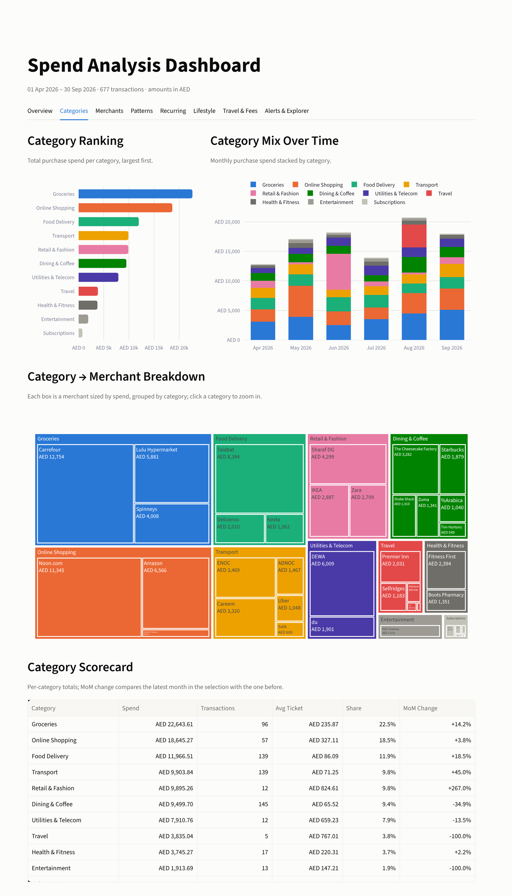
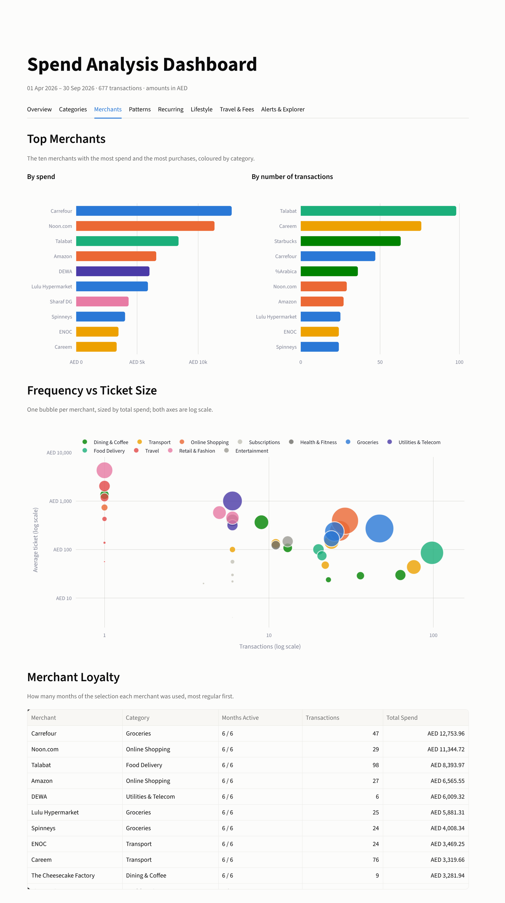
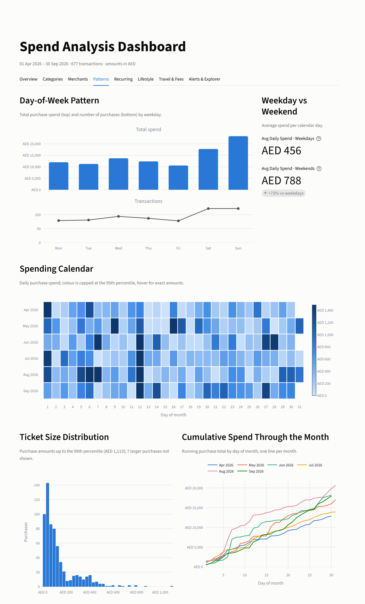
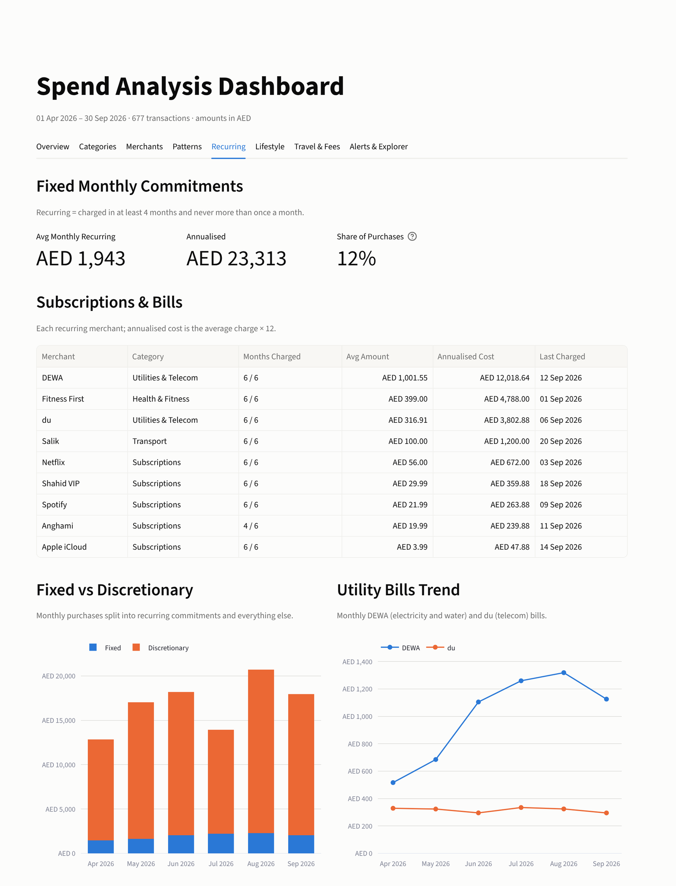
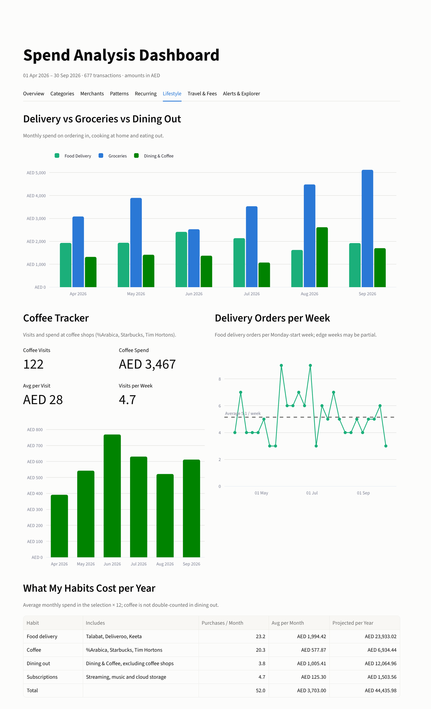
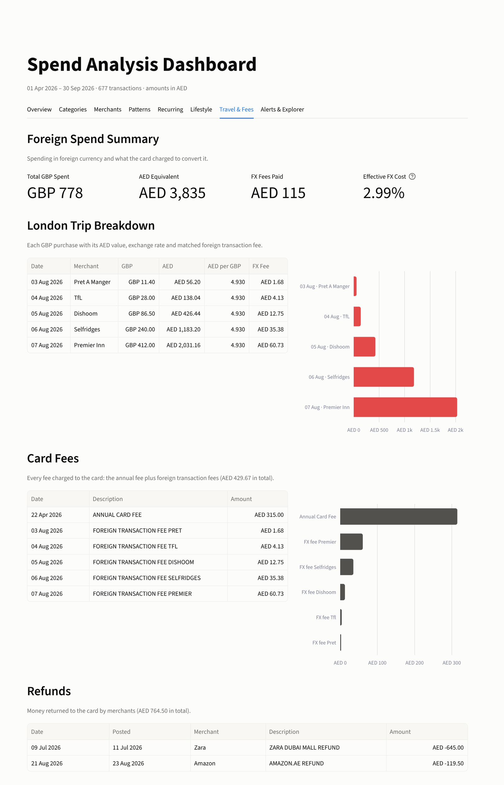
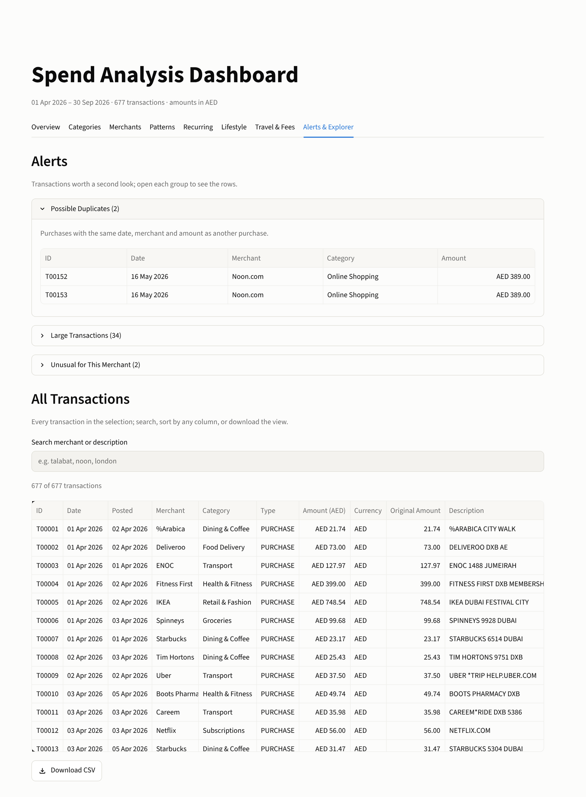

# Spend Analysis Dashboard

An interactive Streamlit dashboard that turns six months of credit card
transactions (1 April – 30 September 2026, amounts in AED) into clear answers:
where the money goes, what everyday habits cost, which bills and subscriptions
recur every month, what travel and card fees added up to, and which transactions
deserve a second look.


**Built with:** Python · Streamlit · pandas · Plotly · uv · VS Code + Claude Code

> 🎥 **Demo video:** _add your link here_

## Highlights

- **8 tabs**, all driven by one set of sidebar filters: date range, categories,
  merchants, and toggles to exclude travel or large purchases.
- **Clean categorisation.** 262 raw card descriptions such as
  `UBER *TRIP HELP.UBER.COM` are mapped to a clean merchant and one of 14
  categories through an editable `merchant_map.csv`.
- **Automatic flags.** Recurring charges, possible duplicate charges, large
  purchases, foreign-currency spend, and amounts unusual for a merchant.
- **Auto-generated insights**, plus an **AI Analyst** box that answers
  plain-English questions. The answers are calculated locally from the data,
  with no external AI service or API key.
- **Correct money logic.** Card payments are never counted as spend, refunds
  reduce spend, and fees are tracked separately.

## Tabs

| Tab | What it answers |
|---|---|
| **Overview** | How much did I spend, and how does each month compare? Which categories take the most? Are card payments keeping up with purchases? |
| **Categories** | Which categories cost the most, how does the mix change month to month, and which merchants make up each category? |
| **Merchants** | Where do I spend the most money, and where do I shop most often? |
| **Patterns** | Which days of the week do I spend most? Are weekends more expensive? |
| **Recurring** | What are my fixed monthly commitments, and what do they cost per year? |
| **Lifestyle** | How do delivery, groceries and dining out compare? What do coffee and delivery habits cost per year? |
| **Travel & Fees** | What did the London trip cost, including foreign transaction fees? What card fees and refunds were there? |
| **Alerts & Explorer** | Possible duplicates, unusually large charges, and out-of-character amounts. Search, sort and download every transaction. |

## Screenshots

### Categories
Groceries and online shopping lead. The monthly mix shows a large electronics
purchase in June and a London trip in August.



<details>
<summary><b>More screenshots</b>: Merchants, Patterns, Recurring, Lifestyle, Travel &amp; Fees, Alerts</summary>

### Merchants
Top merchants by spend versus by number of purchases.



### Patterns
Spend by weekday. An average weekend day costs about 73% more than a weekday.



### Recurring
Bills and subscriptions detected automatically: about AED 1,900 a month.



### Lifestyle
Delivery versus groceries versus dining out, a coffee tracker, and yearly habit costs.



### Travel & Fees
The London trip in GBP and AED, with each foreign transaction fee matched to its purchase.



### Alerts & Explorer
A possible duplicate charge, large transactions, and a searchable list of every transaction.



</details>

## Run it locally

The project is managed with [uv](https://docs.astral.sh/uv/) and needs Python 3.12 or later.

1. Install uv if you don't have it:

   ```bash
   # Windows (PowerShell)
   powershell -ExecutionPolicy ByPass -c "irm https://astral.sh/uv/install.ps1 | iex"

   # macOS / Linux
   curl -LsSf https://astral.sh/uv/install.sh | sh
   ```

2. Clone the repository and install the dependencies:

   ```bash
   git clone https://github.com/liajohn18/Agentic-AI-Projects.git
   cd Agentic-AI-Projects/spend-dashboard
   uv sync
   ```

3. Start the dashboard:

   ```bash
   uv run streamlit run app.py
   ```

It opens at <http://localhost:8501>. If that port is busy, add `--server.port 8503`.

### Helper scripts

```bash
uv run python scripts/build_merchant_map.py   # rebuild data/merchant_map.csv from transactions.csv
uv run python scripts/test_load.py            # check loading, categories and flags
uv run python scripts/test_metrics.py         # print every KPI on the full data
```

## How it was built

I built this in **VS Code with the Claude Code extension**, working in small,
verified steps rather than generating everything at once:

1. **Project brief: [`CLAUDE.md`](CLAUDE.md).** It sets the goal, the data
   columns, the business rules (for example, *card payments are never spend*),
   the folder structure, and **sanity checks** with known values, such as total
   purchases of about AED 100,700, so every step could be verified.
2. **Step-by-step prompts: [`PROMPTS.md`](PROMPTS.md).** There are 14 prompts,
   from setup through the merchant map, data loader, KPI functions and each tab,
   to final polish. Each prompt ends with checks, and I moved on only when they
   passed.
3. **Review at each step.** I reviewed the merchant categories by hand and
   compared KPIs against the sanity checks. After the polish step, every tab was
   cross-checked against `CLAUDE.md`.

## Project structure

```
app.py                  entry point: page config, sidebar filters, tabs
CLAUDE.md               project brief and rules used while building
PROMPTS.md              the step-by-step build prompts
.streamlit/config.toml  light theme and Streamlit settings
data/
  transactions.csv      sample card transactions (677 rows)
  merchant_map.csv      raw description -> clean merchant name and category
src/
  load.py               load, clean and enrich the data (cached); filter helper
  metrics.py            KPI calculations and AED / % / date formatting
  charts.py             one function per chart, each returns a Plotly figure;
                        CATEGORY_COLORS defines one fixed colour per category
  chat.py               rule-based question answering for the AI Analyst box
  tabs/                 one module per tab, each with render(df)
scripts/                merchant-map builder and sanity-check scripts
docs/screenshots/       images used in this README
```

## How the numbers are defined

- **Spend:** PURCHASE rows. **Net spend** is purchases plus refunds; refunds are negative amounts.
- **Card payments** (PAYMENT rows) are bill payments and are never counted as spend.
- **Fees** (the annual card fee and foreign transaction fees) are tracked separately.
- **Recurring:** a merchant charged in at least 4 months, and never more than once in a month.
- **Large:** a purchase above the 95th percentile of purchase amounts.
- **Possible duplicate:** another purchase on the same date, at the same merchant, for the same amount.
- **Unusual for this merchant:** more than 2 standard deviations above that merchant's average.

## About the data

`data/transactions.csv` is a **sample dataset** included to demonstrate the
dashboard. To use your own data, provide a CSV with the same columns (`txn_id`,
`txn_date`, `post_date`, `description`, `amount_aed`, `original_currency`,
`original_amount`, `txn_type`). Then update `data/merchant_map.csv` so every
description maps to a merchant and category.
