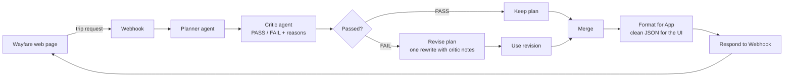

# Wayfare — an AI trip-planning agent, evaluated

**A travel-planning agent built in n8n, with a human-graded evaluation loop that found its main failure mode, fixed it with one prompt change, and measured the result.**

> The planner is the easy part. Trust is the product.

 

---

## What it does

You tell Wayfare where you want to go, your dates, travellers, budget and must-haves (daytime flights, breakfast, free cancellation…). The agent picks the best flight and hotel, explains why, totals the cost against your budget, and flags risks such as non-refundable fares or things it cannot confirm.

It is a **planning-only** agent. It cannot search, book, hold or pay — by design. It chooses only from a supplied list of flights and hotels, which makes every answer **checkable**: if it quotes a price that is not in the list, it invented it.

## Architecture



| Step | n8n node | What it does |
|---|---|---|
| Receive | Webhook → Set | Receives the trip request from the page |
| Plan | AI Agent + OpenAI (gpt-5-mini) | Writes the plan using only the supplied flights and hotels |
| Check | AI Agent + OpenAI (gpt-4.1-mini, temperature 0) + Structured Output Parser | Checks rules, data, maths, risks and false promises; returns `verdict`, `score`, `issues`, `feedback` |
| Decide | If | PASS goes straight on; FAIL goes to one rewrite |
| Revise | AI Agent (same prompt as Planner) | Rewrites the plan once using the Critic's notes |
| Merge | Set + Merge | Puts both paths into one shape and joins them |
| Present | AI Agent + Structured Output Parser | Turns the plan into app-ready JSON (headline, flights, hotel, total, warnings) |
| Respond | Respond to Webhook | Sends the result back to the page |

There are **two workflows that share the same core**:

- **Travel Planner Evaluation** — the test lab. Upload a CSV of test trips, get a CSV of plans to grade.
- **Trip Planner API** — the product. One trip in from the web page, one formatted plan back.

The live app runs exactly the prompts that were evaluated, so what was measured is what users get. The Formatter sits *after* the evaluated output and only changes presentation.

## How it was evaluated

**1. A test set with traps.** Ten trip requests (`data/test_trips.csv`), each with its own supplied flights and hotels and one deliberate trap: the cheapest flight is a red-eye, the cheap return lands on Monday when the traveller must be back on Sunday, a budget that cannot be met, a must-have the data cannot confirm, a transit-visa problem, a cheaper hotel that is too far from the venue.

**2. Five pass/fail dimensions.** Every plan is graded by a human. All five must pass; one fail fails the plan. No scores or averages.

| Dimension | Fails when |
|---|---|
| Constraint Compliance | Any hard requirement is broken (dates, travellers, budget, rules, word limit) |
| Grounding | Anything is invented, or a number or calculation is wrong |
| Recommendation Value | A clearly worse option is chosen, or a suggested alternative would not actually work |
| Risk & Honesty | A risk in the data is not flagged, an unknown is treated as confirmed, or it offers abilities it does not have |
| Clarity & Tone | A traveller could not follow it on one read |

**3. Failure analysis.** Each failure gets one main category, a likely cause (found by inspecting what the model actually received in n8n) and a proposed fix. See `evaluation/Trip_Planner_Evaluation.xlsx` → Failure Analysis and Failure Traces.

**4. One change, then rerun.** One instruction is changed. The failed requests plus passing ones (as a regression check) are rerun unchanged and graded again.

## Results

### Baseline — Planner v1 (10 trips)

- **6 / 10 passed.**
- **3 of 4 failures were the same problem: over-promising.** The agent ended with offers it cannot fulfil — "check and list halal restaurants near the hotel", "compare prices if you move your dates", "use hotels beyond the approved list".
- **The AI Critic agreed with the human grades on only 5 / 10 trips.** It passed the over-promising plans and failed two good ones. The Critic guides generation; the human grade is the record.

### Root cause

The v1 prompt said "you do not book or pay", but never said the agent cannot search, look things up, hold reservations or send links — and gave no instruction on how to end. So the model ended the way chat models do: with a helpful-sounding offer.

### The fix — Planner v2 (one instruction added)

> You cannot search, look up information, check live prices or availability, hold or reserve anything, or send links, and you cannot use any flight, hotel or price that is not in the Approved data. Never offer to do any of these. End with one short question about the plan itself, such as which option the traveller prefers.

### After — same 6 requests (4 failed + 2 passed)

| | Planner v1 | Planner v2 |
|---|---|---|
| Passed | 2 / 6 | **5 / 6** |
| Over-promising failures | 3 | **0** |
| Regressions (pass → fail) | — | **0** |

**Still failing:** the impossible-budget trip (Tokyo). Under v2 it "solved" the budget by recommending 1 adult for 2 nights instead of the requested 2 adults for 7 nights — a new failure type (Constraint Violation), probably a side effect of the new "end with a question about the options" instruction. Candidate fix for v3: never change travellers, dates or nights in the recommendation; such changes may only be offered as options.

## Engineering notes

- **A hidden space broke the routing.** A leading space before `{{ }}` in the If node made `"  PASS"` never equal `"PASS"`, so every plan went down the FAIL path. The same space put a tab in front of every Test ID.
- **The Critic was not consistent.** On identical runs it passed 5 / 10, then 0 / 10. Vague rules ("flag important risks") let it demand general travel advice that was never in the data. Clarifying the rules, switching to gpt-4.1-mini and setting temperature to 0 made it repeatable (7 / 10 on two consecutive runs). The Critic was then frozen so the before/after comparison measures the Planner only.
- **Presentation is a separate layer.** The Formatter removes internal option codes and wording without touching the evaluated Planner.

## Repository contents

```
wayfare-trip-agent/
├── app/index.html                     The Wayfare web page
├── data/
│   ├── test_trips.csv                 The 10 test requests (Test_ID, User_Input, Model_Output)
│   └── rerun_trips_v2.csv             The 6 requests rerun with Planner v2
├── prompts/
│   ├── planner_prompt_v1.txt, planner_prompt_v2.txt
│   ├── critic_prompt_v1.txt … critic_prompt_v3.txt   (v3 is frozen)
│   └── formatter_prompt.txt
├── results/
│   ├── plans_run1_planner_v1.csv      Baseline outputs
│   └── plans_run2_planner_v2.csv      Rerun outputs
├── evaluation/Trip_Planner_Evaluation.xlsx   Human grading: Evaluation Log, Failure Analysis, Failure Traces, Rubric
├── workflows/                         n8n workflow exports (Evaluation and API)
└── CHANGELOG.md                       Every change: problem, change, expected effect, result
```

## Run it yourself

**You need:** an n8n account (Cloud or self-hosted) and an OpenAI API key.

1. **Credentials.** In n8n, add an OpenAI credential. Keep keys in n8n only — never in prompts, files or the page.
2. **Import the workflows** from `workflows/` (n8n → Import from File) and select your OpenAI credential on every model node.
3. **Evaluate.** In *Travel Planner Evaluation*, click Execute workflow, upload `data/test_trips.csv`, and download the output CSV from the last node. Grade it in the workbook.
4. **Go live.** In *Trip Planner API*, set the workflow to Active and copy the Webhook's **Production URL**.
5. **Open the app.** Open `app/index.html` in a browser, click ⚙, paste the URL, and plan a trip.

**Cost and safety.** Each trip makes 3–4 small-model calls. Set a monthly spending limit in your OpenAI account, keep auto-recharge off, share the URL only with people you trust, and deactivate the workflow between demos.

## Limitations

- **Ten test cases** is a diagnostic set for finding failure patterns, not a benchmark.
- **Sample data only.** Flights, hotels and prices are fictional; there are no live searches and no bookings.
- **One rewrite, not re-checked.** A revised plan does not go back through the Critic.
- **The Formatter is not yet evaluated.** It is instructed to use only the plan's facts, but has no test set of its own.
- **One human grader.** Judgment calls (for example, which offers count as over-promising) are written into the rubric to keep grading consistent.

## Next steps

- Planner v3 for the impossible-budget case, then rerun the full set.
- Grow the test set to 30–50 cases, including multi-city and family trips.
- Calibrate an LLM judge for one failure category against the human labels (agreement, misses, false alarms).
- Loop revisions back through the Critic with an attempt limit.
- Add a real flight and hotel search tool once behaviour on fixed data is solid.

---

Built by **Lia Elizabeth John** — [LinkedIn](https://www.linkedin.com/in/liaelizabethjohn) · [GitHub](https://github.com/liajohn18)
